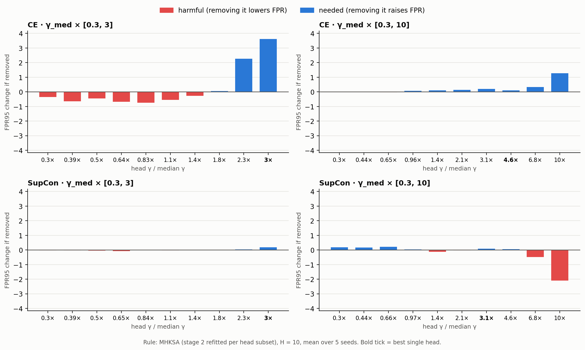
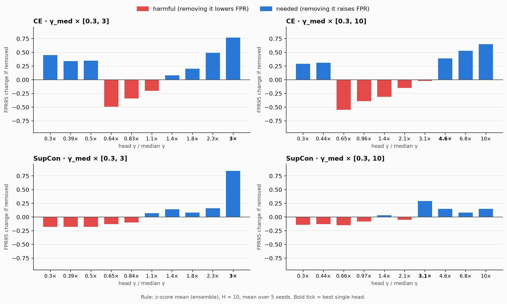

# 나쁜 head의 영향력

CIFAR10 · ResNet18, H = 10, seed 5개 평균, FPR95 (↓)

- MHKSA: 실제 MHKSA. head 조합마다 2단계 PCA를 ID train으로 다시 학습 (head 10개 전부 = 체크포인트 MHKSA와 일치, 점수 차이 1e-6 이하)
- Ensemble: z-score 평균 (실제 앙상블과 동일)

## 나쁜 절반의 피해

| 조건 | 규칙 | 전체 10개 | 좋은 절반만 | 피해 |
| --- | --- | --- | --- | --- |
| CE · 0.3×~3× | MHKSA | 35.39 | 33.32 | +2.08 |
| CE · 0.3×~3× | Ensemble | 32.38 | 30.90 | +1.47 |
| CE · 0.3×~10× | MHKSA | 27.39 | 27.90 | −0.50 |
| CE · 0.3×~10× | Ensemble | 29.04 | 28.12 | +0.92 |
| SupCon · 0.3×~3× | MHKSA | 9.42 | 9.26 | +0.16 |
| SupCon · 0.3×~3× | Ensemble | 9.68 | 8.59 | +1.09 |
| SupCon · 0.3×~10× | MHKSA | 9.96 | 9.83 | +0.13 |
| SupCon · 0.3×~10× | Ensemble | 8.63 | 8.21 | +0.41 |

- 좋은/나쁜 절반: 단일 head(CoRP) FPR 순위로 나눔 (분석용, 테스트 OOD 사용)
- 피해 = 전체 − 좋은 절반만 (+ = 나쁜 절반이 섞여서 손해)

## head 하나씩 빼기 (FPR 변화, − = 빼면 좋아짐 = 해로운 head)

| 조건 | 규칙 | 해로운 구간 | 필요한 구간 |
| --- | --- | --- | --- |
| CE · 0.3×~3× | MHKSA | 0.3× ~ 1.4× (−0.27 ~ −0.74) | 2.3× ~ 3× (+2.27 ~ +3.62) |
| CE · 0.3×~3× | Ensemble | 0.64× ~ 1.1× (−0.20 ~ −0.49) | 0.3× ~ 0.5× (+0.34 ~ +0.45), 1.4× ~ 3× (+0.08 ~ +0.77) |
| CE · 0.3×~10× | MHKSA | 0.3× ~ 0.65× (−0.01 ~ −0.03, 거의 0) | 10× (+1.27), 나머지 +0.07 ~ +0.33 |
| CE · 0.3×~10× | Ensemble | 0.65× ~ 3.1× (−0.02 ~ −0.55) | 0.3× ~ 0.44× (+0.29 ~ +0.31), 4.6× ~ 10× (+0.39 ~ +0.65) |
| SupCon · 0.3×~3× | MHKSA | 없음 (모두 ±0.07 이내) | 3× (+0.18) |
| SupCon · 0.3×~3× | Ensemble | 0.3× ~ 0.84× (−0.10 ~ −0.18) | 1.1× ~ 3× (+0.07 ~ +0.84) |
| SupCon · 0.3×~10× | MHKSA | **10× (−2.10)**, 6.8× (−0.49) | 0.3× ~ 0.65× (+0.17 ~ +0.21) |
| SupCon · 0.3×~10× | Ensemble | 0.3× ~ 0.97×, 2.1× (−0.05 ~ −0.15) | 3.1× ~ 10× (+0.08 ~ +0.29) |

- MHKSA는 가장 큰 γ head 1 ~ 2개가 결과를 좌우함 (하나 빼면 최대 3.6%p 변화). 작은 γ head는 거의 영향 없음
- 앙상블은 영향이 head에 고르게 퍼져 있음 (하나 빼도 대부분 ±0.5%p 이내)
- SupCon ×10에서 MHKSA가 나빠진 직접 원인: 10× head (빼면 9.96 → 7.86)

